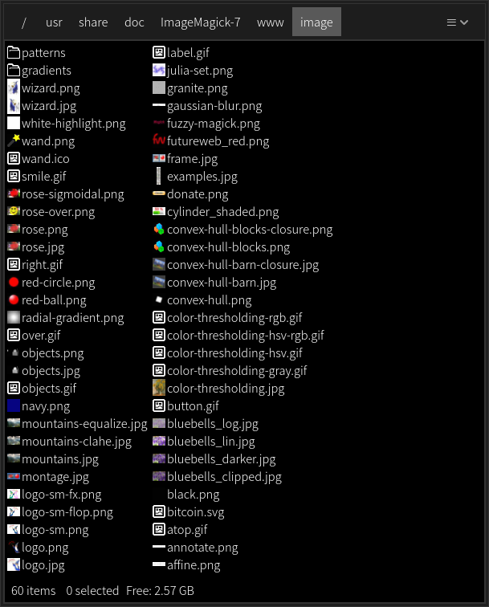

# Trout

Trout is a GTK4 file manager.



Features
* Usable with large directories (10k+ files)
* Immediate thumbnail pre-generation for the current directory and subdirectories
* Custom action buttons and right-click actions
* Automatic directory merging
* Queued file operations with pause and device parallelization
* Tabs

## Custom actions
Custom actions are loaded at startup from `$XDG_CONFIG_HOME/trout/actions` (normally `~/.config/trout/actions`). The file uses LF line endings. Each non-empty line has this format, with single spaces between fields:

```text
label appearance type extensions command argument ...
```

`label` has no spaces. `appearance` is `c` for the entry context menu, `b` for a button in the header bar, or `cb` for both. `type` is `d` for directories, `f` for non-directory entries, or `fd` for both. `extensions` is a comma-separated list without leading dots, matched case-sensitively against the filename suffix after its final dot. Use `*` to match any extension. An action is shown only when every selected entry matches its type and extension filters.

The command and its arguments are split on spaces and run directly without a shell. Configured tokens cannot contain spaces; quoting and escaping are not supported. Trout appends each selected entry's full path as a separate argument, so paths containing spaces remain a single argument. No string interpolation is performed.

## Keyboard
* Start typing to select a file by file name prefix
* Ctrl+l to edit the address
* Ctrl+x, Ctrl+c, Ctrl+v to cut, copy, and paste selected files
* Ctrl+t to create a new tab
* Ctrl+n to create a new window
* Ctrl+w to close the tab
* Ctrl+q to close all tabs

## Build
Run `./exe/compile` to create `exe/compiled/trout`.

Trout was inspired by Thunar to improve on various issues:
* Thumbnail creation only as files scroll into view, which is too late
* Directory replace requiring a copy of files instead of merging with renames
* Excessive slow-downs when selecting many files in large directories
* Not automatically continuing the queue after an item was manually paused
